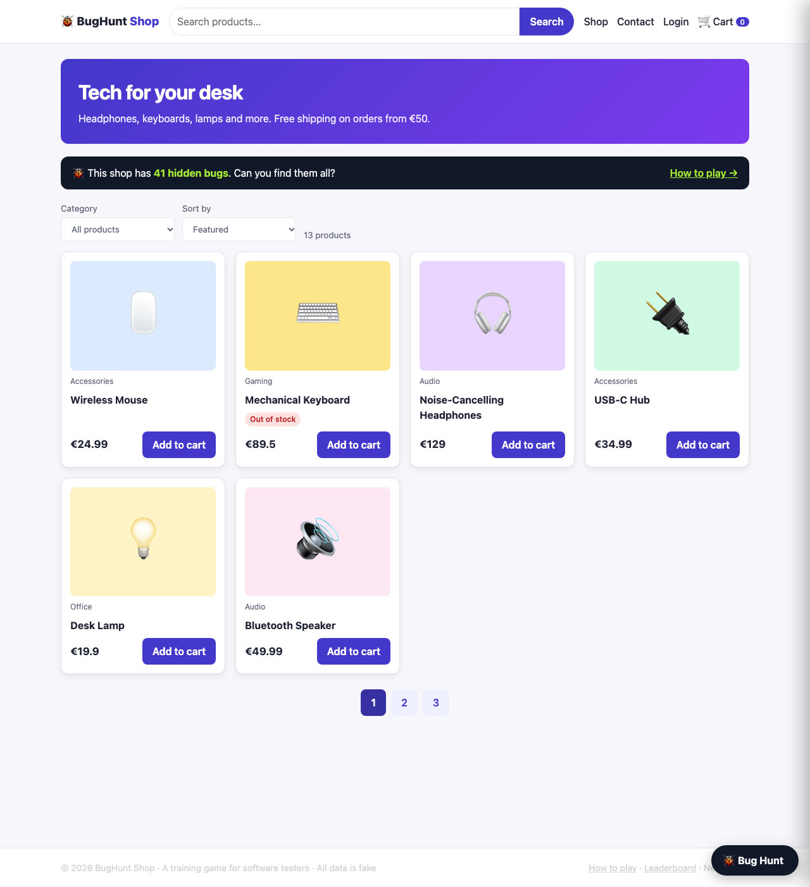
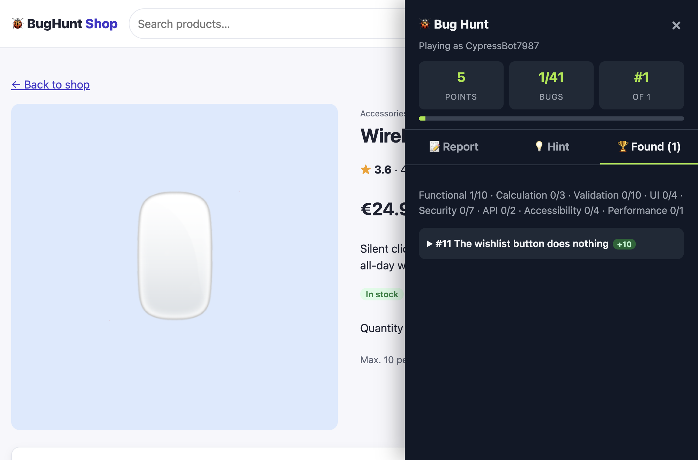

# 🐞 Find the Bug — BugHunt Shop

**A deliberately buggy online shop with 41 hidden bugs: a hands-on training game for software testers.**

Explore a realistic web shop, find the bugs, report them like a professional tester and climb the leaderboard. Every confirmed bug shows **why it happens**, **how to prevent it** and the **ISTQB test technique** that finds it.



## Why I built this

I work as a QA engineer. Most practice sites for testers are either too simple or have no feedback loop. You click around and never know whether you found everything.

BugHunt Shop is built the other way round. I designed each bug on purpose, the way real bugs get into real products: an off-by-one in pagination, a `=` instead of `===`, a validation rule that exists only in the browser, or a server that trusts the price the client sends.

## Features

- 🛒 **Realistic shop**: product list, search, product pages and reviews, cart and coupons, checkout, login/register, order history, contact form
- 🐞 **41 planted bugs** in 8 categories, 3 difficulty levels
- 📝 **In-app bug reporting**: choose page, feature and category, then describe steps and expected vs. actual
- 💡 **Hints tied to ISTQB techniques** (boundary value analysis, equivalence partitioning, decision tables, state transitions, error guessing)
- 🎓 **Learning feedback** for every bug found: root cause, prevention and technique
- 🏆 **Leaderboard** with points and report accuracy
- 🔒 **Safe to host publicly**: data each player creates (accounts, orders, reviews) is scoped to that player, so security bugs like XSS can never affect anyone else



## Bug categories

| Category | Bugs | Examples of what to look for |
|---|---|---|
| Functional | 10 | Features that do the wrong thing |
| Validation | 10 | Boundaries, formats, required fields |
| Security | 7 | OWASP Top 10: XSS, IDOR, data exposure, business logic |
| UI | 4 | Formatting, stale state |
| Accessibility | 4 | WCAG: alt text, labels, contrast, keyboard |
| Calculation | 3 | Totals, averages, thresholds |
| API | 2 | Error handling, server-side checks |
| Performance | 1 | Slow responses |

## Quick start

```bash
git clone https://github.com/VaishaliBurge29/find-the-bug.git
cd find-the-bug
npm install
npm start
```

Open **http://localhost:3000**, click **🐞 Bug Hunt** in the bottom-right corner and choose a nickname.

- Demo login: `anna@example.com` / `Password123`
- Test card: `4111 1111 1111 1111`
- Tools welcome: browser DevTools, Postman/Hoppscotch, axe, Lighthouse

> ⚠️ **Spoiler warning:** `server/bugs.js` is the answer key. Don't open it if you want to play.

## Scoring

| Action | Points |
|---|---|
| Easy / medium / hard bug | +10 / +20 / +30 |
| Hint | −5 |
| Wrong report | −2 |

A report counts when the page and category match a bug, and the feature or your description points to it. Write it like a real bug report and you'll be fine.

## Tests

```bash
npm test
```

The suite (Node's built-in test runner, no extra dependencies) checks two things:

1. **The game works.** Scoring, duplicates, hints, unique nicknames, and player data isolation.
2. **The bugs still exist.** These are regression tests in reverse. If a refactoring accidentally "fixes" a planted bug, a test fails.

## Tech stack

- **Backend:** Node.js, Express (shop API with planted bugs, plus the game API)
- **Frontend:** Plain HTML, CSS and JavaScript, no build step
- **Storage:** In-memory shop data, JSON file for players and scores

```
server/
  index.js      – app setup
  shop.js       – shop API (🐞 bugs live here…)
  hunt.js       – game API: reports, hints, leaderboard
  bugs.js       – answer key (spoilers!)
  shopData.js   – seed products, users and orders
public/         – shop pages + common.js (header, cart, Bug Hunt panel)
tests/          – API tests
```

## Roadmap

- [ ] Cypress + Cucumber (BDD) suite that documents each bug as a Gherkin scenario
- [ ] German language version
- [ ] Team mode and timed "bug bash" events
- [ ] Deploy a public demo

## License

MIT. Use it for training, workshops and teaching.
